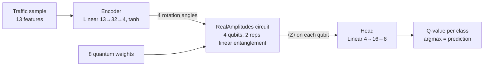

# Quantum-Enhanced Reinforcement Learning for Cyber Defense

[](https://www.python.org/downloads/)
[](https://pytorch.org/)
[](https://www.ibm.com/quantum/qiskit)
[](https://quantum.cloud.ibm.com/)
[](LICENSE)

B.Tech capstone project (VIT Bhopal University, 2026) comparing a **classical Deep Q-Network (DQN)** with a **hybrid quantum-classical DQN (QDQN)** for 8-class network threat classification. The QDQN was trained and evaluated on **IBM's 156-qubit `ibm_fez` processor** within the IBM Quantum free tier.

| | |
|---|---|
| **Task** | Classify network traffic into 8 classes: benign, botnet, DoS, phishing, port scan, ransomware, SQL injection, XSS |
| **RL formulation** | Contextual bandit: each sample is a context, the action is a class, reward is 1 if correct |
| **Quantum model** | Classical encoder → 4-qubit `RealAmplitudes` circuit → Pauli-Z expectation values → classical Q-value head |
| **Hardware** | IBM `ibm_fez` via Qiskit Runtime `EstimatorV2`, 7 jobs |
| **Outcome** | A working hardware pipeline and a cost analysis; no accuracy difference at this sample size (see [Results](#results)) |

## Results

| Metric | Classical DQN | Quantum DQN |
|---|---|---|
| Accuracy (20 test samples) | 10.0% | 15.0% |
| Weighted F1 | 0.033 | 0.039 |
| Training time | 0.12 s | 380 s |

Both models are at chance level (12.5% for 8 classes) and differ by one test sample, so **this run does not show a quantum advantage**. The training budget (60 samples, 6 gradient updates) was set by free-tier quantum time. What the project does show is that the hybrid pipeline runs end to end on real hardware, and what that costs: about 3,100× the classical wall-clock time for the same updates. Full analysis, confidence intervals and next steps: **[RESULTS.md](RESULTS.md)**.

## Architecture



The classical baseline is an MLP (13 → 128 → 128 → 8, about 19k parameters) trained with experience replay and a soft-updated target network.

## How it works

- **Data** ([`data/dataset.csv`](data/dataset.csv)): 400 network traffic samples with packet rate, byte rate, flow duration, source/destination bytes, TCP flags, TTL variance, failed logins, URL length, entropy and protocol. Numeric features are standardized and protocol is one-hot encoded, giving 13 features.
- **Environment** ([`environment.py`](environment.py)): a contextual bandit that presents one sample per step and rewards a correct classification.
- **Quantum network** ([`quantum_network.py`](quantum_network.py)): the circuit's first rotation layer encodes the 4 encoder outputs; the remaining 8 rotation angles are quantum weights. The circuit is transpiled once for the backend (optimization level 2), observables are mapped onto the physical qubits, and samples are batched into 20-circuit jobs so the whole run fits in free-plan limits.
- **Fair comparison** ([`train.py`](train.py)): fixed seed, identical training and test subsets, equal epochs, batch size and gradient-update budget for both models.
- **Dashboard** ([`frontend/`](frontend)): a React app visualizing the results and the IBM Quantum jobs used.

## Quick start

```bash
git clone https://github.com/CodesByLucky/Quantum-Enhanced-Reinforcement-Learning-Model-for-Cyber-Defense.git
cd Quantum-Enhanced-Reinforcement-Learning-Model-for-Cyber-Defense
pip install -r requirements.txt

# Local statevector simulator: no IBM Quantum account needed
python train.py --mode compare
```

### Run on IBM Quantum hardware

Get an API key from [IBM Quantum](https://quantum.cloud.ibm.com/), then save it once:

```bash
python config.py            # prompts for the key, or reads IBM_QUANTUM_TOKEN / IBM_QUANTUM_INSTANCE
python config.py --verify   # lists available backends

python train.py --mode compare --real-hardware            # least busy backend
python train.py --mode compare --real-hardware --backend ibm_fez
```

### Options

```
--mode {dqn,qdqn,compare}  Which model(s) to train (default: compare)
--real-hardware            Run the quantum circuit on IBM Quantum hardware
--backend NAME             Specific IBM Quantum backend
--epochs N                 Epochs (default: 2)
--batch-size N             Batch size (default: 20)
--updates-per-epoch N      Gradient updates per epoch (default: 3)
--train-samples N          Training samples (default: 60)
--test-samples N           Test samples (default: 20)
--qubits N                 Qubits (default: 4)
--shots N                  Shots per circuit on hardware (default: 256)
--max-quantum-jobs N       Job budget (default: 8)
--output-dir DIR           Where checkpoints and results.json go (default: checkpoints)
```

## Project structure

```
├── train.py              # Fair-comparison training and evaluation
├── quantum_network.py    # Hybrid quantum Q-network and QDQN agent
├── models.py             # Classical DQN agent
├── environment.py        # Contextual-bandit environment
├── utils.py              # Data loading, preprocessing, replay buffer, MLP
├── config.py             # IBM Quantum credential setup
├── data/dataset.csv      # 400 samples, 8 classes
├── checkpoints/          # Models and results.json from the reported hardware run
├── RESULTS.md            # Full results and analysis
├── docs/                 # Capstone project report (PDF)
└── frontend/             # React results dashboard
```

## Limitations and future work

- **Sample size:** 60 training and 20 test samples cannot separate the two models statistically.
- **Circuit training:** the circuit runs outside PyTorch autograd, so only the classical head is trained. Parameter-shift gradients (for example qiskit-machine-learning's `EstimatorQNN` with `TorchConnector`) are the next step.
- **Bandit target:** the update uses a discounted next-state target (γ = 0.99), but samples are independent; a reward-only target (γ = 0) fits the bandit setting better.
- **Observable mapping:** the reported hardware run read one expectation value per physical qubit (156) because observables were not mapped through the transpiler layout. The code now maps them to the 4 circuit qubits; see [RESULTS.md](RESULTS.md).
- **Scale:** next, evaluate on full datasets such as NSL-KDD, UNSW-NB15 or CICIDS on the simulator before spending hardware time.

## Team

Capstone project, School of Computing Science and Artificial Intelligence, VIT Bhopal University, supervised by **Dr. D. Saravanan**.

- **Lucky Samant**, team lead, ML/RL ([luckysamant.in](https://luckysamant.in) · [LinkedIn](https://www.linkedin.com/in/luckysamant/) · [GitHub](https://github.com/CodesByLucky))
- Naman Sharma
- Abhay Pratap Singh
- Tushar Bhadane
- Manas Bhatt

Full report: [docs/Quantum_Cyber_Defence_Report.pdf](docs/Quantum_Cyber_Defence_Report.pdf)

## Citation

```bibtex
@misc{samant2026qrlcyber,
  title        = {Quantum-Enhanced Reinforcement Learning for Autonomous Cyber Defence},
  author       = {Samant, Lucky and Sharma, Naman and Singh, Abhay Pratap and Bhadane, Tushar and Bhatt, Manas},
  year         = {2026},
  howpublished = {\url{https://github.com/CodesByLucky/Quantum-Enhanced-Reinforcement-Learning-Model-for-Cyber-Defense}},
  note         = {B.Tech capstone project, VIT Bhopal University}
}
```

## Acknowledgments

IBM Quantum for hardware access, and the Qiskit and PyTorch teams.

## License

MIT. See [LICENSE](LICENSE).
